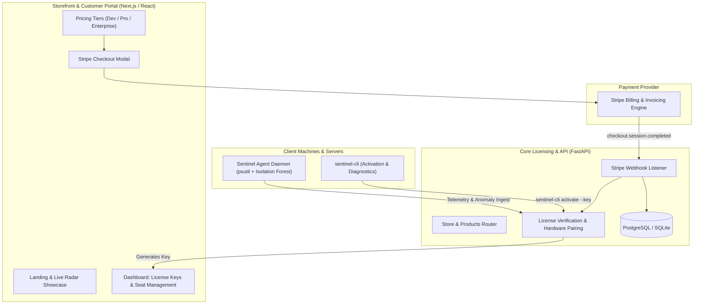
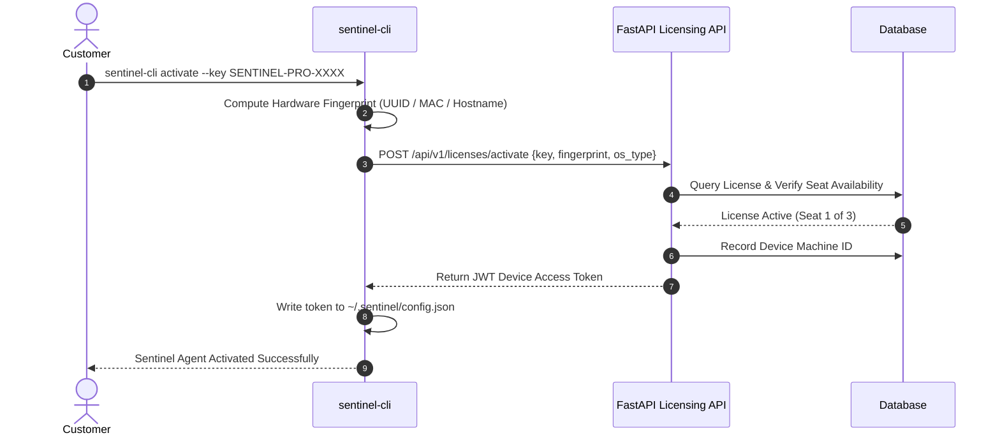

# Sentinel AI — Intelligent Early Warning System & Store Platform

<div align="center">
  <h3>Detect the unusual. Explain the risk. Act before it escalates.</h3>
  <p>An intelligent system monitoring and anomaly early-warning platform with integrated software licensing, subscription store, and fleet telemetry.</p>
</div>

---

## 📌 Overview

**Sentinel AI** bridges traditional system metric monitoring and automated anomaly prevention. Instead of showing isolated readings and static thresholds, Sentinel AI learns baseline behavioral patterns across CPU, RAM, network, and process activity, detects anomalies using unsupervised machine learning (Isolation Forest), and delivers clear, human-understandable explanations with recommended safe actions.

This repository contains the complete full-stack solution:
1. **Storefront & Customer Portal (`/frontend`)**: Next.js & React-based e-commerce platform for purchasing subscriptions, managing device seats, and downloading client agents.
2. **Licensing & Billing Engine (`/backend`)**: FastAPI service with Stripe checkout integration, subscription management, and hardware-fingerprinted license activation.
3. **Sentinel Client Agent (`/sentinel_agent`)**: Python daemon utilizing `psutil` and `scikit-learn` for telemetry collection, anomaly inference, and alert generation.

---

## 🏛 Architecture



---

## 💼 Commercial Tiers & SKUs

| Tier | Target Audience | Seats | Key Capabilities |
| :--- | :--- | :--- | :--- |
| **Community** | Personal Laptops | 1 device | Local anomaly detection, baseline CPU/RAM tracker |
| **Developer Pro** | Workstations | 3 devices | Process & network telemetry, threshold tuning, priority notifications |
| **Server Node** | Cloud VMs & Dedicated | 1 server | Headless daemon, webhook integrations (Slack/PagerDuty), metrics export |
| **Enterprise Fleet** | Infrastructure & Labs | 25+ seats | Centralized cloud monitoring, fleet risk scoring, SAML SSO |

---

## 🚀 Quick Start Guide

### Prerequisites
- Docker & Docker Compose **OR** Python 3.10+ and Node.js 18+

### 1. Launch with Docker Compose
Clone the repository and spin up the full stack:
```bash
git clone https://github.com/YOUR_USERNAME/sentinel-ai-store.git
cd sentinel-ai-store
docker-compose up --build
```
- **Storefront**: [http://localhost:3000](http://localhost:3000)
- **Licensing API Docs**: [http://localhost:8000/docs](http://localhost:8000/docs)

---

### 2. Manual Development Setup

#### Backend (FastAPI Licensing Service)
```bash
cd backend
python -m venv venv
# Linux/macOS: source venv/bin/activate | Windows: venv\Scripts\activate
pip install -r requirements.txt
uvicorn app.main:app --reload --port 8000
```

#### Frontend (Next.js Storefront)
```bash
cd frontend
npm install
npm run dev
```

#### Running the Local Sentinel Agent
```bash
cd sentinel_agent
pip install -r requirements.txt
python sentinel_cli.py activate --key SENTINEL-PRO-DEMO-2026
python sentinel_cli.py start
```

---

## 🔑 License Activation Workflow



---

## 📁 Repository Structure

```text
.
├── backend/
│   ├── app/
│   │   ├── routers/
│   │   │   ├── licenses.py     # Activation, heartbeat, seat tracking
│   │   │   ├── store.py        # Catalog & Stripe checkout sessions
│   │   │   └── webhooks.py     # Stripe billing events
│   │   ├── config.py           # App configuration & secrets
│   │   ├── database.py         # SQLAlchemy DB connection
│   │   ├── models.py           # Database entities
│   │   └── main.py             # FastAPI entrypoint
│   ├── Dockerfile
│   └── requirements.txt
├── frontend/
│   ├── src/
│   │   ├── app/
│   │   │   ├── page.tsx        # Storefront landing & pricing
│   │   │   └── portal/page.tsx # Customer license dashboard
│   │   └── components/         # UI widgets (Hero, Radar, Pricing)
│   ├── package.json
│   └── Dockerfile
├── sentinel_agent/
│   ├── detector.py             # Isolation Forest anomaly detection
│   ├── monitor.py              # psutil hardware metric sampler
│   ├── sentinel_cli.py         # Client activation CLI
│   └── requirements.txt
├── docker-compose.yml
└── README.md
```

---

## 📄 License
This project is licensed under the MIT License - see the [LICENSE](LICENSE) file for details.
